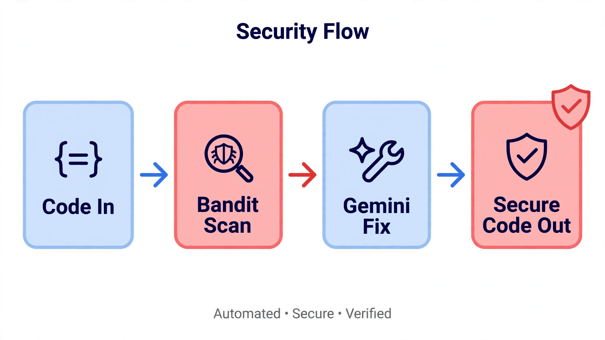

# 🛡 Autonomous Code Auditor


> An AI-powered agent that scans code for security vulnerabilities — and rewrites just the flagged lines into secure code, keeping everything else untouched.



## ⚙️ How It Works

1. **Bandit scan** — a static security scan runs over the target file.
2. **Gemini agent** — reads your code together with the Bandit report and fixes only the flagged vulnerabilities, such as SQL injection, command injection, and hardcoded secrets.
3. **Fixed code out** — you get back clean, secure code with the original functionality preserved.

## 👀 See It In Action

The repo includes a before/after demo pair:

- `vulnerable_app.py` — sample code with security flaws
- `fixed_app.py` — the same code, secured

## 🚀 Setup

```bash
git clone https://github.com/waki44/Autonomous-code-autitor.git
cd Autonomous-code-autitor

pip install bandit google-genai python-dotenv
```

Create a `.env` file with your key (and keep it out of git — add `.env` to `.gitignore`):

```text
GEMINI_API_KEY=your_key_here
```

Then audit any file:

```python
from main import audit_and_fix_code

audit_and_fix_code("vulnerable_app.py")
```

## 📂 Project Structure

```text
├── main.py              # Bandit scan + Gemini fix pipeline
├── auditor_agent.py     # Agent logic
├── auditor_module.py    # Audit module
├── vulnerable_app.py    # Demo: insecure sample code
├── fixed_app.py         # Demo: secured version
└── testcode.py          # Sample code for testing
```

## 🔍 What It Catches

OWASP Top 10 issues including SQL injection, command injection, hardcoded secrets, dangerous cryptography, and insecure configurations — with a context-aware fix for each one.

---

Built by **Syed Waqar Raza Zaidi** · 🌐 [Portfolio](https://portfolio-website-sigma-ashen-90.vercel.app)
